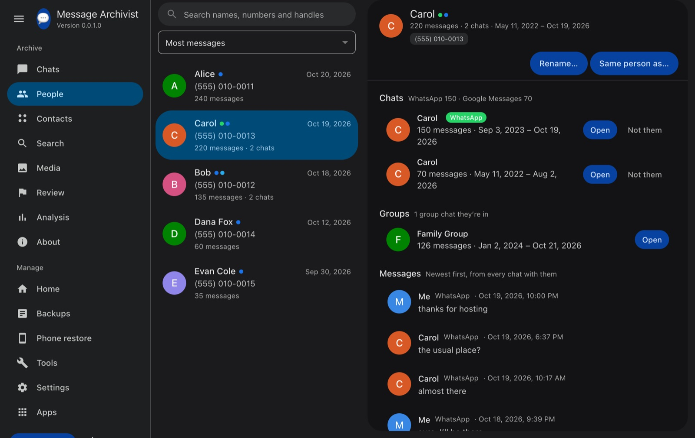
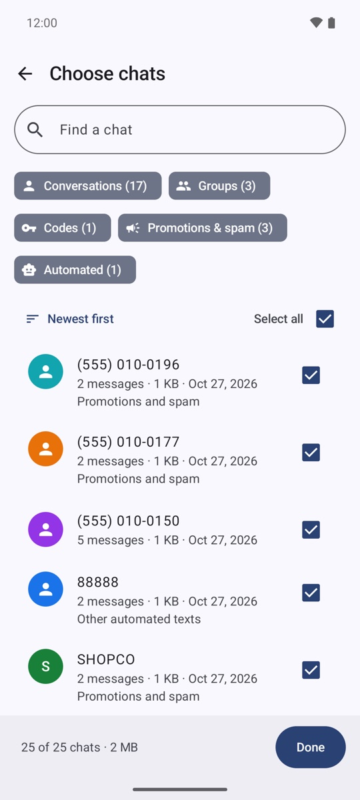

# Message Archivist

[](https://github.com/trikhster/message-archivist/actions/workflows/ci.yml)
[](https://github.com/trikhster/message-archivist/releases)
[](LICENSE)

**Message Archivist** keeps your conversations for good, on your own devices: one archive of your texts and your chats from other apps. It comes in parts that work together:

- **For Chrome:** an extension that backs up your [Google Messages for Web](https://messages.google.com/web) conversations to a folder on your own computer: every message, photo, GIF, video and voice note, with who sent it and when. It keeps the backup up to date, checks that it's complete, and lets you read, search and analyse everything offline.
- **For Android:** an app that backs a phone's texts up to one file in minutes, keeps that file up to date by itself, and puts a backup back on a phone. See [The Android app](#the-android-app).
- **As an app on your computer:** the archive in a window of its own, with its own icon, installed from Chrome or Edge and running on them: read, search and keep everything, bring in phone backups and other apps' chats, and it works offline. See [The app](#the-app).

The same archive takes in your chats from **WhatsApp, Telegram, Discord, Instagram, Messenger and TikTok**, from the export each app makes, so every conversation is in one place, searchable together. It knows **who's who** across them (one person's texts, WhatsApp and Telegram, even from two numbers), and can write the whole archive as **notes for Obsidian**. See [Other apps](#other-apps), [People](#people) and [Obsidian](#obsidian).

They're pre-releases (versions 0.x): they work well, and they're still changing.

<p align="center">
  
  
</p>

- **Back up one chat or every chat.** Messages are saved straight into one backup folder as they're read, so nothing is lost if Chrome closes, and the next backup carries on where it stopped. After that only new messages are added, by hand or on a schedule.
- **Know it's complete.** Each chat is checked every time it's saved: that its very first message was reached (and on what evidence), that the newest messages are saved, that there are no duplicates and that every photo is in. "Back up everything" also checks every conversation in Google Messages against the backup.
- **Everything, byte for byte.** Photos at full size, GIFs, videos and audio exactly as Messages has them, plus contact names, numbers and photos.
- **Start from your phone.** Message Archivist's Android app backs a phone's texts up in minutes (years of them; Google Messages for Web takes hours), can keep that file up to date by itself (as often as every hour), on the phone or Google Drive, and the extension brings it in and carries on from there: it recognises the messages already in, and adds what the phone doesn't keep.
- **Back on your phone.** The same app puts a backup back into a phone's messages: every chat with a number, group chats, photos and videos, in order, without duplicates. Years of texts are fine. (SMS Backup & Restore's format is available too.)
- **Built for years of texts.** Long chats are saved as they're read and don't slow down as they grow; the viewer draws a month at a time, so a chat of 100,000 messages opens in seconds.
- **Every photo accounted for.** Each chat keeps a master list of its photos and videos with their status (full size, thumbnail, not fetched yet, failed…). Do a quick speed run for the messages, then fetch the photos or upgrade thumbnails to full size later, without reading the whole chat again.
- **One page per person.** The same person's chats in every app, account and number come together on their page, with one timeline of everything you've said to each other. See [People](#people).
- **Notes for Obsidian.** Turn the archive into an Obsidian vault: a note for every person and chat, the messages a year at a time, photos shown where they were sent. See [Obsidian](#obsidian).
- **Codes and spam kept apart.** Chats of verification codes, promotions and spam, and other automated texts are kept out of your chats, People, search and analysis, in folders of their own, and you can leave them out of your archive altogether. See [Codes and spam](#codes-and-spam).
- **Labels, flags and folders.** Mark chats or single messages as Favorites, Family, Spam or your own labels, at any time after a backup; each label is a folder. A Review tab gathers everything flagged or labelled in one place.
- **Runs on its own.** Backups move Google Messages into a small window in a corner of the screen, so you can keep working, and scheduled backups open it themselves when it isn't open.
- **Read it anywhere.** "Open my backup" shows the chats in a Google Messages-style viewer with search, a media gallery, a timeline scrubber and analysis: activity per week and month, a year in review, who replies how fast, longest silences, and more. Every chart drills down to the messages behind it.
- **Made for people who aren't technical.** Step-by-step setup, a popup that always says what to do next, and plain progress and results.
- **Evidence-grade records.** SHA-256 checksums for every file, a log of every run, Google's message IDs and the exact on-screen timestamps.
- **Private.** Everything runs in your browser. Nothing is sent anywhere. See [PRIVACY.md](PRIVACY.md).

> Not affiliated with, endorsed by, or sponsored by Google. “Google” and “Google Messages” are trademarks of Google LLC.

## Install

1. Download `message-archivist-extension-v<version>.zip` from the newest release on the [Releases page](https://github.com/trikhster/message-archivist/releases) and unzip it.
2. Open `chrome://extensions` in Chrome, turn on **Developer mode** (top right), click **Load unpacked**, and choose the unzipped folder.
3. A setup page opens. It walks you through four steps: choose a folder for your backups, start with a backup from your phone (made with [the Android app](#the-android-app); skip it if you have no Android phone to hand), open Google Messages and connect your phone, and back up everything.

To update, download the new release, replace the folder's contents, click the reload icon on the extension in `chrome://extensions`, and reload your Google Messages tab.

The full **[user guide](extension/README.md)** covers everything else.

<p align="center">
  
  
</p>

## Good to know

- Google Messages for Web loads old messages from your phone, so the phone has to stay on and connected while a backup runs. Long chats can take a while.
- Leave the Google Messages tab alone while it works; a panel in the middle of the page says what it's doing.
- Archived chats aren't in Messages' main list. Open each one and back it up from the popup.
- Works in Chrome and other Chromium browsers that support folder access (Edge, Brave). It relies on Google Messages' page layout; if Google changes it, please [report it](https://github.com/trikhster/message-archivist/issues/new/choose).

## Other apps

The archive isn't only for texts. Bring in your chats from other apps and they sit beside your text messages, each marked with its app, in the same viewer, search and analysis.

| App | What to export | Notes |
|---|---|---|
| WhatsApp | open a chat → ⋮ → More → **Export chat** (Android), or tap the name → **Export Chat** (iPhone); choose **Attach media** | one chat per export; the .zip (or .txt). Put several in one folder and bring in the folder |
| Telegram | Telegram Desktop → Settings → Advanced → **Export Telegram data**, format **Machine-readable JSON** | every chat at once, with photos |
| Discord | User Settings → Data & Privacy → **Request all of my data** | Discord's package has **only the messages you sent**; attachments are links |
| Instagram, Messenger | Accounts Center → Your information and permissions → **Download your information**, Messages, **JSON** | every chat, with photos and videos; not Messenger's end-to-end encrypted chats (next row) |
| Messenger's encrypted chats | Messenger on a computer → Settings → Privacy & safety → End-to-end encrypted chats → Message storage → **Download secure storage data** | most Messenger chats since 2024, with photos |
| TikTok | Settings and privacy → Account → **Download your data**, **JSON** | direct messages; shared videos are links |

Then in the extension's Settings → *Tools* → **Bring in conversations**, click **Bring in files…** and pick the file (or **Bring in a folder…** for an unzipped export, or a folder of them). It shows what's in it before anything is added. If an export doesn't say which name is yours, it asks once and remembers. A download that came in several parts: unzip them all into one folder and bring in the folder. If you pick something it can't read but recognises (Facebook's HTML version, say), it says what to download instead. Settings' **Apps** tab has a card for each app: how to get its export, what your archive has from it and when it last came in, and a button to bring more in.

**On your Android phone**, the Message Archivist app has a section for each of these apps too. Share a chat to it from WhatsApp (open the chat → ⋮ → More → **Export chat** → Message Archivist), or a Facebook, Instagram, TikTok or Discord download you got on the phone (or **Add a file…** in that app's section): it goes into your next phone backup, and into your archive when you bring that backup in.

- **Bring in a newer export whenever you like.** Only messages that aren't in the archive yet are added.
- **Each source's chats stay separate.** Your texts and your WhatsApp chat with the same person are two conversations, each as that app had it. Texts are kept apart by where they came from too: Google Messages' texts, and later iMessage's. **A second number** (another phone, a work number) is kept apart within its app, labelled with the number, e.g. "Google Messages · (555) 019-9999". In the viewer, a chat with someone shows "Also in WhatsApp · Telegram" to jump to their chats in other apps, and **All apps** narrows the list to one.
- **Everything is read on your computer.** No logins to those apps, nothing uploaded. Their chats can't go back on a phone as texts; that's for text messages only.
- **iMessage and Signal** aren't supported yet: iMessage lives in a database on your Mac, and Signal has no plain export.

## People

The viewer's **People** tab puts each person's chats together, whatever app, account or number they were in.

<p align="center">
  
</p>

- **Joined by themselves** when chats share a **phone number** (in any app: your texts and a WhatsApp chat with the same number), an **email address**, or the same **username or ID in one app** (one Telegram contact seen from two of your accounts).
- **Suggested** when only the **name** matches: "Sam Rivers" in your texts and "Sam Rivers" on Instagram could be two people, so you say. **Same person** joins them; **Not the same** stops asking. With a long list, join them all at once.
- **You decide the rest.** **Same person as…** joins anyone by name, number or handle; **Not them** takes a chat off someone; **Rename…** gives them the name you know them by.
- **A person's page** has their numbers and handles, every chat with them (open any), the groups they're in, and **one timeline** of every message between you, across all of it. Each chat's header says who it's with and links to their page.

What you decide is saved in your backup folder (`people.json`), changed only from "Open my backup" (the folder's own `index.html` shows it, read-only).

## Codes and spam

Years of texts include a lot of one-time codes, promotions and automated texts. Message Archivist tells those chats apart from your real conversations:

- **Verification codes**: "123456 is your verification code", "Don't share it".
- **Promotions and spam**: "Reply STOP to opt out", "Msg&data rates may apply", and links with prize-or-package wording from numbers you don't know.
- **Other automated texts**: alerts, deliveries and reminders from short codes and business names.

It judges each chat by who sent it and what came in, and never touches a group, a chat you've labelled, or a chat you've talked in: three messages of yours, or any reply to one of your contacts.

- **In the viewer** they're kept out of All chats, People, Search, Media and Analysis, in their own folders (🔑 Codes, 📣 Promotions, 🤖 Automated). **Show them everywhere** puts them back. If one is a real conversation, open it and click **It's not**.
- **To leave them out of your archive**, tick them in Settings → *Leave out of your archive*. "Back up everything" then skips them, and so does bringing in phone backups and other apps' exports. **Find the ones already in my archive…** lists those already saved and moves them into the archive's `removed-chats` folder, after you've seen the list. Delete that folder to remove them for good. Untick a box and those chats are backed up again.
- **On your phone**, the Android app has the same three switches (Settings → *Leave out of phone backups*), so its backups leave them out too, judged the same way. A starred contact is never left out.

## Obsidian

[Obsidian](https://obsidian.md) can be a home for your messages: in the extension's Settings → *Tools* → **Obsidian**, click **Write the notes**, then in Obsidian choose **Open folder as vault** and pick your **backup folder itself**.

- **A note for every person** (their numbers, apps and chats, the groups they're in) **and every chat** (who it's with, its labels as tags), linked together, with a home note to start from.
- **Each person's note is the place to start**: how much you talk and who usually starts, how fast you each reply, the years at a glance, when in the day and week you talk, and the moments of your chats (the first message, the busiest day, the longest streak and the longest silence), each a link to that day in the messages. Their photos and links have notes of their own. With **Save all my contacts** on in the Android app, your whole address book comes into the archive and ties chats from every app to the right person: a WhatsApp chat by the contact's name, a Telegram chat from their other number. Backed up from your phone, it also shows their contact photo, nickname, work, birthday (and how many of their birthdays you were in touch on), your contact labels as notes of their own, and relations from your contacts.
- **Connected**: the topics you talk about with more than one person are notes of their own, linking those people, and each person's note links the people named in your chats with them and the people they're in groups with, so Obsidian's graph shows who's connected to whom. The People note also lists who you've talked to most recently and who you've lost touch with. People you've never written to (codes, alerts, businesses, spam) are marked **one-way** and kept out of all that, so they don't crowd the people who matter. All of this is worked out on your computer, from your backup.
- **What you talk about, in words and phrases**: each person's note lists the words and phrases that stand out in your chats ("fantasy football", "dog park"), and what you talked about each year; a topic you share with more than one person is a note of its own, with when it first and last came up and the day it came up most.
- **A calendar**: a note for every year (the months, the people of the year, who was new, what was talked about, the events, the busiest days) and every month, day by day: who you talked to, each a link to that day in the chat, and the day's photos.
- **Events found in your messages**: birthday wishes (so even contacts without a birthday get a likely one, and your own birthday shows up), congratulations and a guess at what for, holiday greetings, travel ("just landed in…"), meeting up ("on my way", "I'm outside") and days of many photos, each a link to its day. They're written as likely, not certain; nothing about illness or loss is looked for.
- **Every photo, by day**: one place with every photo and video from every chat, by day and by chat, beside a calendar link.
- **A timeline for each person**: everything notable with them, year by year. And a group chat's note says who talks most in it.
- **The messages** go a year to a note (a busy year a month to a note; a short chat keeps them in its own note), each day a heading, **photos and videos shown** where they were sent. They're shown from the chats' own folders, never copied.
- **Keep them up to date after every backup and import**: only what changed is written again.
- **Delete the notes** with *Delete the notes…*: two steps, saying how many notes you've written in and that it can't be undone; your backup isn't touched, and the notes can be written again (your own writing can't).
- **Write your own notes** below the "Your notes" line of a person, chat, topic, year or month note (the calendar makes a good journal): they're kept when the notes are updated. (The message notes themselves are rewritten.)
- They go in an `Obsidian` folder in your backup folder and never leave your computer, unless you sync that vault yourself (Obsidian Sync or a cloud folder would upload them, as it would the rest of the folder).

## The app

The archive can also be an app on your computer, in a window of its own with its own icon in the Dock, Start menu or taskbar, no browser tabs. It runs on Chrome or Edge, the browser you already have, so there's nothing else to download.

1. Open **[trikhster.github.io/message-archivist/app](https://trikhster.github.io/message-archivist/app/)** in Chrome or Edge.
2. Click **Install** in the address bar (or **Install the app** at the top of the page).
3. In the app, choose your backup folder: the same one the extension saves to, if you use it. Your browser asks once to let the app use it; choose **Allow on every visit**.

From then on the app opens on your archive, with one menu down the left: your chats, people, contacts, search, media and analysis, then Home, Backups, Phone restore, Tools, Settings and Apps.

What it does:
- **Everything with your archive**: read and search it ([People](#people) too), bring in phone backups and other apps' chats, write the [Obsidian](#obsidian) notes, check your backup, and make the file that puts texts back on a phone.
- **Opens phone backups for you**: open a `.tar` from the Android app with Message Archivist (Finder or Explorer → Open with), and it's brought in.
- **Works offline**: after the first visit the app has its own copy, so it opens with no internet.
- **Backing up Google Messages is still the extension's job**: the app shows what the extension saves into the same folder.
- **Nothing leaves your computer**: the app is a set of files served from this repository; it reads and writes only the folder you choose, and sends nothing anywhere (see [PRIVACY.md](PRIVACY.md)).
- **Updates come with each release**: a new version is ready the next time you open the app (or click **Restart now** when it says so). Each release lists the SHA-256 of every file the app is made of.

## The Android app

**Message Archivist for Android** backs up the texts on an Android phone and puts them back. It reads the phone's own copy of your messages, so years of texts and photos take minutes instead of the hours Google Messages for Web needs to scroll through them. It saves them in the extension's format: the extension can bring a phone backup into your computer backup, and the app can restore a backup the extension made.

<p align="center">
  
  
  
  
</p>

### Install the app

It needs Android 8 or later. Until it's on Google Play, it's installed by hand:

1. On the phone, download `message-archivist-android-v<version>.apk` from the newest release on the [Releases page](https://github.com/trikhster/message-archivist/releases). (Or download it on a computer and copy it to the phone.)
2. Open it. Android asks to allow installing apps from your browser or Files: allow it, then install.
3. Open **Message Archivist**. The first time you back up, it asks to read your texts, your contacts (optional: for chat names, favorites and contact photos) and to show notifications. If Android says reading texts is a *restricted setting*, open the app's info page (long-press its icon → **App info**), tap ⋮ → **Allow restricted settings**, and try again.

### The first screen

The first screen has a section for each app. **Google Messages** comes first: the texts, picture messages and chats on the phone, backed up by the app itself. Below it are WhatsApp, Messenger, Instagram, TikTok and Discord, whose exports you share to the app (see [Other apps](#other-apps)). Google Messages' card says where your backup stands:

- **Your texts are backed up**: when the last backup ran, and to which file.
- **Automatic backup is on**: it's set up and the first one runs soon.
- **The last backup didn't work**: with the reason.
- **Your texts aren't backed up yet**.

Under it are how many messages, chats and photos and videos are on the phone and one button: **Back up now** once automatic backup is on, otherwise **Back up this phone** (after the first backup, the app offers to keep it up to date). If the last backup didn't work, **Settings** is there too, to fix it. Below the card: **Back up to another file** (a one-off copy in a file of its own, once automatic backup is on) and **Restore a backup**. The gear at the top opens Settings. The app follows the phone's light or dark theme, and on Android 12 and later its colours too.

### Back up a phone

1. Tap **Back up this phone** (or **Back up to another file**). It shows how many messages, chats and photos the phone has.
2. Leave **Include photos and videos** on for a complete copy, or turn it off for a small, quick file and add the photos later.
3. To back up only some chats, tap **Chats**, tick the ones you want and tap **Done**. Find them by name or number, sort them (newest or oldest first, most or fewest messages, largest or smallest, name; each chat shows its size), or use **Select all**. The chips at the top filter by type (**Conversations**, **Groups**, **Codes**, **Promotions & spam**, **Automated**): a type you hide isn't backed up, and the ones Settings leaves out start hidden. Leave it alone for every chat. Updating a backup with only some chats brings just those up to date; its other chats stay as they were.
4. Tap **Save backup** and choose where to keep it: Downloads, Google Drive, or anywhere else the phone offers. The file is called `messages-backup-<date>.tar`.
5. It shows its progress (the messages, chats and photos so far, the chat it's on and the time left), also in a notification, so you can leave the app. **Stop** keeps the chats finished so far as a working backup.
6. **Backup saved** gives the file's name and size and its counts, with:
   - **Back up automatically**: keeps this file up to date by itself (see [Keep it up to date](#keep-it-up-to-date)).
   - **Next: your computer backup**: how to bring the file into the extension (after a new backup).
   - For a file on Google Drive, a reminder that Drive shows it as 0 bytes until the Drive app has uploaded it.
   - **Done**, and **Share**, which sends the file to any app, such as Drive, email or Nearby Share.

What a backup holds:

- Every text and picture message in every chat, group chats included, with its exact time and who sent it. Drafts and messages that never sent are left out.
- Photos, videos and audio, byte for byte (unless you turned them off). A picture that arrives more than once (forwarded, or sent to two chats) is stored once.

The messages are compressed, so a backup without photos is small (a tenth of the text's size or less); with photos, it's mostly the photos. Older versions of the app and the extension can't read backups from this version: update both.
- Each chat's people: their name and number, whether they're a favorite (a starred contact), and their contact photo. A group text's numbers are kept apart, not run together.
- Chat (RCS) messages as Google Messages keeps them on the phone (see [Good to know about the app](#good-to-know-about-the-app)).

Backing up never changes your SMS app. On a test phone, 38,281 messages and 262 photos took about 2½ minutes (50 seconds without the photos).

### Keep it up to date

- **Update a backup instead…** (on the backup screen) picks a backup you made before and adds only what's new: the messages since, and its photos if it was made without them and **Include photos and videos** is on now. Messages since deleted from the phone stay in the backup. A file on the phone's own storage is added to in place, in seconds. A file on Google Drive can't be added to: the app adds to its copy on the phone (see **Keep a copy on this phone**) and uploads it whole.
- **Automatic backup** does the same by itself, in the background. Turn it on with **Back up automatically** after a backup, or in Settings with **Back up by itself**, which asks for a **New file…** (backed up straight away) or **A backup I already have…** (brought up to date straight away). The first screen shows how the last one went.

<p align="center">
  
  
</p>

Settings (the gear on the first screen) has the same sections as the first screen, **Google Messages** first:

| Setting | What it does | Starts as |
|---|---|---|
| **Back up by itself** | Turns automatic backup on or off. | Off |
| **Last backup** | When it last ran and how many messages it added (or why it didn't work), with **Back up now**. | |
| **Backup file** | The file it keeps up to date, on this phone or online. **Change** picks another. | The file you chose |
| **How often** | Every hour, 6 hours, 12 hours, day or week, or **Custom…**: any number of hours or days, from 1 hour to 30 days. Android picks the exact time, when the battery isn't low, and may wait longer to save battery. A file kept online is uploaded whole each time, so frequent backups with photos use a lot of data. | Day |
| **Include photos and videos** | Off makes a smaller file; the photos can be added later. | On |
| **Only while charging** | Waits until the phone is plugged in. | Off |
| **Only on Wi-Fi** | So a file kept online doesn't use mobile data. | On for a file online, off for one on the phone |
| **Tell me after each backup** | A quiet notification with how many messages were added. A backup that goes wrong is always shown. | Off |
| **Keep a copy on this phone** | For a file online (under *Backup online*): the app keeps a copy of it in its own storage on the phone, adds each backup to that and uploads it, so the file online is never downloaded first. Settings shows how much room it takes; turning it off deletes it, and each backup then downloads the file online first. It's left out when the phone is short of space. | On |
| **Upload less: a small updates file** | For a file online (under *Backup online*): a second, small file beside it that each run writes instead of re-uploading the big one. **Set up…** makes it and fills it straight away; **Stop using** goes back to updating the big file every time. | Off |
| **Leave out of phone backups** | **Verification codes**, **Promotions and spam** and **Other automated texts**: chats of these aren't written into any backup, by hand or automatic, and a backup made before drops them the next time it's brought up to date. Groups, starred contacts and chats you've talked in are always kept. The same rules as the extension's ([Codes and spam](#codes-and-spam)). | Off |
| **About** | The version, a reminder that the app has no internet access, and **App permissions** (Android's settings page for the app). | |

### Put a backup back on a phone

<p align="center">
  
  
  
  
</p>

1. Copy a backup to the phone: one made with **Back up this phone**, or one the extension made (its Settings → **Phone restore** → **Make the restore file**).
2. Open Message Archivist on the phone, tap **Restore a backup** and pick the file (or open the file from Files or Google Drive with Message Archivist).
3. Check what's in it before anything on the phone changes: the backup's date, its messages, chats and photos and videos (with their size), roughly how long the restore takes, and every chat with its message count and years. All chats are ticked; untick any you don't want (**Select all** shows a dash when only some are ticked). If there are group chats and the phone doesn't know its own number, a box asks for it.
4. Tap **Restore N messages**. Android asks to make Message Archivist your **default SMS app**: say yes. Android only lets the SMS app add messages, so it needs to be, for the length of the restore.
5. It shows the percentage, the chat it's on, the time left, and how many texts, picture and group messages, and messages already on the phone it has done. A notification shows the same with **Stop**, so you can leave the app.
6. **Your messages are back**, with the counts. Then **One more step**: tap **Switch back to Google Messages** (or **Choose SMS app in Settings**) and say yes when Google Messages asks to be your SMS app again. The app then says **You're all set**.

It's safe to restore again:

- **Nothing is added twice.** Messages already on the phone are skipped; restoring the same file again just says **Already on this phone**.
- **Stopping keeps what's done.** **Restore again** carries on where it stopped.
- **Texts that arrive during a restore are kept**, with a notification. A picture message that arrives is fetched by Google Messages once it's your SMS app again.
- **Group chats come back as group chats**, with their photos and videos, in order.
- While Message Archivist is still your SMS app, a banner says so, with **Switch back**. It doesn't send texts: an app that asks it to gets a note to use Google Messages.

On a test phone, 38,281 messages went back in about 7½ minutes.

### With the extension

- **Phone first, then the extension.** In the extension's Settings → *Tools* → **Bring in files…**, pick the .tar (and its updates file, if you use one). Chats are matched by phone number and their messages are marked "From phone"; when the extension next backs those chats up, it adds what the phone doesn't keep (the chat messages below, contact cards) without saving anything twice. Bring the file in again whenever you like: only what's new is added.
- **Favorites and contact photos** from the phone show in the viewer: favorite chats come first, with ⭐, then names A–Z, then numbers.
- **Computer to phone.** The extension's Settings → **Phone restore** → **Make the restore file** writes a backup the app can restore.

The [user guide](extension/README.md#the-android-app) has the details.

### Permissions and privacy

| Permission | What for | Asked |
|---|---|---|
| Read texts (SMS) | Backing up. | The first time you back up |
| Contacts (optional) | Chat names, favorites and contact photos. | The first time you back up |
| Notifications | Progress, results, and problems with automatic backup. | The first backup or restore |
| Default SMS app | Only during a restore: Android only lets the SMS app add messages. You switch back at the end. | When you tap Restore |
| Run at start-up | Keeps automatic backup scheduled after the phone restarts. | Never: allowed when it's installed |
| Network state | Lets automatic backup wait for Wi-Fi (it only sees whether there's a network; it still can't use it). | Never: allowed when it's installed |

The app has **no internet permission**, so it can't send anything anywhere: your messages go only where you save the file. See [PRIVACY.md](PRIVACY.md).

### Good to know about the app

- **Chat (RCS) messages.** Since mid-2026 a Google Messages bug stops some RCS messages you send being stored on the phone, so no phone backup has them. The extension can still read them: bring the phone backup into the extension and let it back those chats up.
- **A backup on Google Drive: use a small updates file.** Drive can't add to a file, so each run would upload the whole backup again (gigabytes, with years of photos). In Settings, **Upload less: a small updates file** → **Set up…** saves a second, small file beside it: each run then writes only what's new into that file (a few kilobytes on a quiet day), and the big file catches up only once the updates have added up to its size, or every 90 days. To restore or bring it into the extension, use the big file, then the updates file; messages already there are skipped. A file on the phone itself is simply added to in place, in seconds.
- **A backup on Google Drive shows 0 bytes until it's uploaded.** The Drive app uploads it in the background, and some networks (a guest or work Wi-Fi) hold uploads up for a long time. The app keeps a copy on the phone and never reads the file on Drive back, so a backup that hasn't been uploaded yet isn't lost or made again: the next one replaces it. If Drive still shows 0 bytes, open the Drive app and check its uploads.
- **Android decides when automatic backups run**: around the time you chose, when the battery isn't low (and when charging or on Wi-Fi, if you asked). A run Android cuts short keeps what it did and carries on next time.
- **Restored messages are texts and picture messages.** RCS chats go back as ordinary SMS and MMS. Times in a backup the extension made are to the minute (that's what Google Messages for Web shows); a phone backup's are exact.
- **The time left is a guide.** On a slower phone the restore's estimate can start out too high.
- **iPhones can't import texts**, so restoring needs an Android phone.
- **Updating the app.** Every release's APK is signed with the same key, so a new version installs over the old one and keeps your settings. Each release's notes give the key's SHA-256 fingerprint. A test build (a debug APK from the Check workflow, or one you built yourself) has a different signature: uninstall it before installing a release, which turns automatic backup off, but your backup files stay where they are.
- Some launchers shorten the name to "Message Ar…".

## Project layout

```
extension/   the extension itself (load this folder in Chrome)
  manifest.json             extension manifest; its version is the release version
  content.js                runs on messages.google.com: reading chats, backing up, analyzing
  library.js                shared by content.js, Settings and the viewer: merging, the library's index, completeness checks, who's who
  obsidian.js               the archive as notes for Obsidian
  writer.html/js            small extension frame that owns the backup folder and writes into it
  background.js             scheduled jobs, date-range downloads, notifications
  popup.html/js             toolbar popup
  options.html/js           settings page, including import of earlier exports, other apps' exports and backup health
  modules/                  one file per app beside Google Messages (WhatsApp, Instagram/Messenger, Telegram, Discord, TikTok; iMessage and Signal for later): its name, colour, export steps and reader
  import.js                 reads other apps' exports with those modules, including ones a phone backup carries
  viewer.html/js            the archive viewer (copied into the library as index.html + viewer.js, with library.js)
  zip.js                    small zip writer and reader
  theme.css / theme.js      Google Messages-style look, light/dark theme and toggle
  icons/icon.svg            icon source; PNGs are rendered from it
app/                        the app's own files (stand-ins for the extension's APIs, offline copy, manifest, icons); scripts/build-app.mjs adds the extension's pages
android/                    the Android app, which backs a phone up (by itself if asked) and puts backups back (Kotlin, Gradle)
scripts/                    checks, packaging, setting the version
test/                       tests for bringing phone backups and other apps' exports in, people and the Obsidian notes, and tools for comparing backups
notes/                      developer notes (an Obsidian vault; start at notes/Home.md)
docs/screenshots/           pictures for this page (made-up chats); android/ has the app's
.github/workflows/          CI checks and release packaging
```

## Development

See [CONTRIBUTING.md](CONTRIBUTING.md) for how to report problems and suggest changes.

Requires Node.js 18 or later (used only for checks and packaging, not at runtime).

```bash
npm run check
```

That checks every script's syntax, validates the manifest, confirms every file it references exists, and confirms `package.json`, `manifest.json` and the Android app have the same version.

```bash
npm test
```

That brings made-up phone backups and made-up exports from each supported app into a made-up library, and checks that chats are matched by number, nothing is added twice, a later backup from Google Messages for Web recognises the phone's messages, and phone chats are shown as "From phone", with numbers formatted and favorites first.

```bash
npm run package
```

That builds `dist/message-archivist-extension-v<version>.zip`, which is ready to attach to a GitHub release or upload to the Chrome Web Store, and prints its SHA-256.

```bash
npm run serve-app
```

That builds [the app](#the-app) into `dist/site` (`npm run app` alone just builds it) and serves it at http://localhost:8080/app/ on this computer only, so you can install and try it in Chrome or Edge before a release. Ctrl+C stops it; the installed app keeps working offline.

```bash
cd android && ./gradlew assembleDebug
```

That builds the Android app (it needs JDK 17 and the Android SDK) into `android/app/build/outputs/apk/debug/app-debug.apk`. CI builds it on every push too. How it works and how to test it on an emulator: `notes/Modules/Android app.md` and `notes/Testing.md`.

## Versioning and releases

Versions have four parts, production.major.minor.patch, such as 0.0.1.0. The first is 0 until the first production release, and those releases are published as GitHub pre-releases; the other three follow [Semantic Versioning](https://semver.org/) (major for changes that break existing backups or need setup again, minor for new features, patch for fixes). The extension and the Android app share one version.

1. Add the changes under **Unreleased** in [CHANGELOG.md](CHANGELOG.md), then rename that heading to the new version and date.
2. Set the version in `package.json`, the extension's manifest and the Android app, and commit:

   ```bash
   npm run set-version -- 0.0.2.0
   ```

3. Tag the commit and push the tag:

   ```bash
   git tag -a v0.0.2.0 -m "Message Archivist 0.0.2.0"
   ```

   ```bash
   git push origin v0.0.2.0
   ```

When a `v*` tag is pushed, GitHub Actions checks that the tag matches the manifest version, builds the extension zip and the Android APK (signed with the project's key, kept in the repository's secrets), and publishes a GitHub Release with both attached, their SHA-256 checksums and the signing key's fingerprint. See `notes/Releasing.md`.

## License

[Apache License 2.0](LICENSE). See [NOTICE](NOTICE) for attributions.
