# Message Archivist

[](https://github.com/trikhster/message-archivist/actions/workflows/ci.yml)
[](https://github.com/trikhster/message-archivist/releases)
[](LICENSE)

**Message Archivist** keeps your text messages for good, on your own devices. It comes in two parts that work together:

- **For Chrome:** an extension that backs up your [Google Messages for Web](https://messages.google.com/web) conversations to a folder on your own computer: every message, photo, GIF, video and voice note, with who sent it and when. It keeps the backup up to date, checks that it's complete, and lets you read, search and analyse everything offline.
- **For Android:** an app that backs a phone's texts up to one file in minutes, keeps that file up to date by itself, and puts a backup back on a phone. See [The Android app](#the-android-app).

Both are pre-releases (versions 0.x): they work well, and they're still changing.

<p align="center">
  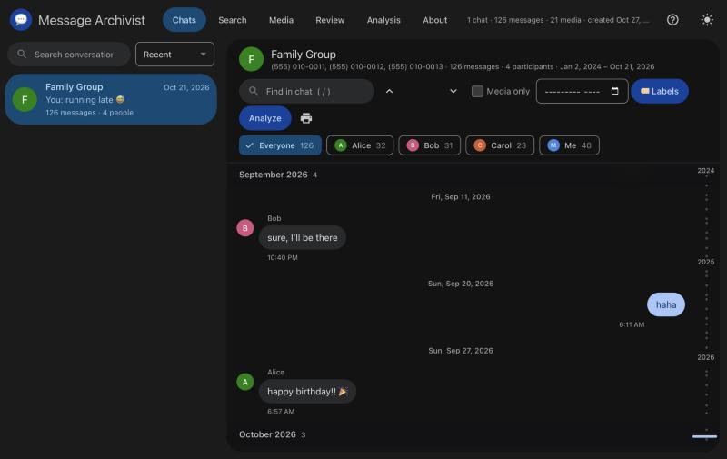
  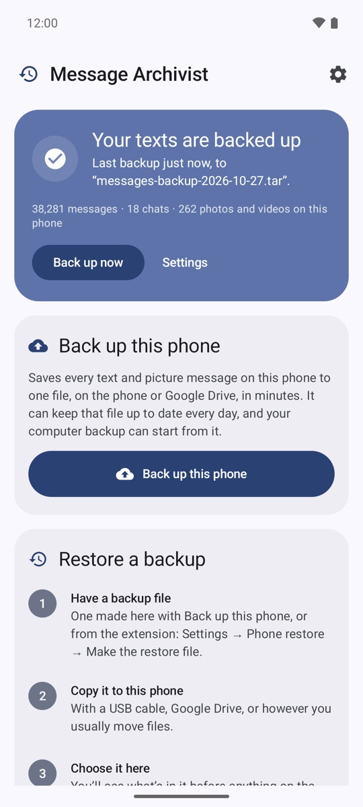
</p>

- **Back up one chat or every chat.** Messages are saved straight into one backup folder as they're read, so nothing is lost if Chrome closes, and the next backup carries on where it stopped. After that only new messages are added, by hand or on a schedule.
- **Know it's complete.** Each chat is checked every time it's saved: that its very first message was reached (and on what evidence), that the newest messages are saved, that there are no duplicates and that every photo is in. "Back up everything" also checks every conversation in Google Messages against the backup.
- **Everything, byte for byte.** Photos at full size, GIFs, videos and audio exactly as Messages has them, plus contact names, numbers and photos.
- **Start from your phone.** Message Archivist's Android app backs a phone's texts up in minutes (years of them; Google Messages for Web takes hours), can keep that file up to date every day, on the phone or Google Drive, and the extension brings it in and carries on from there: it recognises the messages already in, and adds what the phone doesn't keep.
- **Back on your phone.** The same app puts a backup back into a phone's messages: every chat with a number, group chats, photos and videos, in order, without duplicates. Years of texts are fine. (SMS Backup & Restore's format is available too.)
- **Built for years of texts.** Long chats are saved as they're read and don't slow down as they grow; the viewer draws a month at a time, so a chat of 100,000 messages opens in seconds.
- **Every photo accounted for.** Each chat keeps a master list of its photos and videos with their status (full size, thumbnail, not fetched yet, failed…). Do a quick speed run for the messages, then fetch the photos or upgrade thumbnails to full size later, without reading the whole chat again.
- **Labels, flags and folders.** Mark chats or single messages as Favorites, Family, Spam or your own labels, at any time after a backup; each label is a folder. A Review tab gathers everything flagged or labelled in one place.
- **Runs on its own.** Backups move Google Messages into a small window in a corner of the screen, so you can keep working, and scheduled backups open it themselves when it isn't open.
- **Read it anywhere.** "Open my backup" shows the chats in a Google Messages-style viewer with search, a media gallery, a timeline scrubber and analysis: activity per week and month, a year in review, who replies how fast, longest silences, and more. Every chart drills down to the messages behind it.
- **Made for people who aren't technical.** Step-by-step setup, a popup that always says what to do next, and plain progress and results.
- **Evidence-grade records.** SHA-256 checksums for every file, a log of every run, Google's message IDs and the exact on-screen timestamps.
- **Private.** Everything runs in your browser. Nothing is sent anywhere. See [PRIVACY.md](PRIVACY.md).

> Not affiliated with, endorsed by, or sponsored by Google. “Google” and “Google Messages” are trademarks of Google LLC.

## Install

1. Download `message-archivist-extension-v<version>.zip` from the newest release on the [Releases page](https://github.com/trikhster/message-archivist/releases) and unzip it.
2. Open `chrome://extensions` in Chrome, turn on **Developer mode** (top right), click **Load unpacked**, and choose the unzipped folder.
3. A setup page opens. It walks you through four steps: choose a folder for your backups, start with a backup from your phone (made with [the Android app](#the-android-app); skip it if you have no Android phone to hand), open Google Messages and connect your phone, and back up everything.

To update, download the new release, replace the folder's contents, click the reload icon on the extension in `chrome://extensions`, and reload your Google Messages tab.

The full **[user guide](extension/README.md)** covers everything else.

<p align="center">
  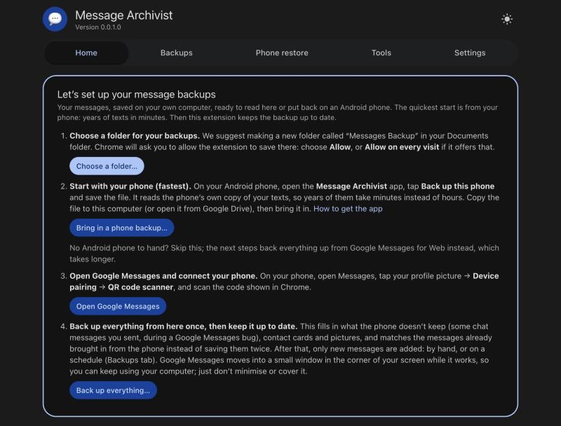
  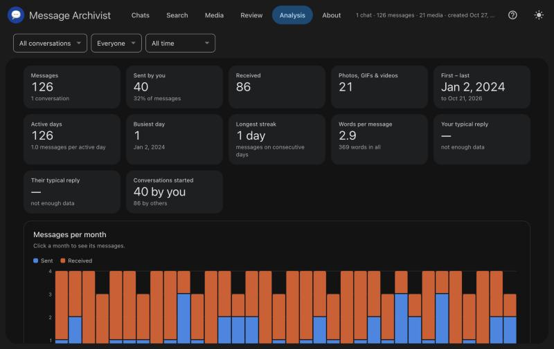
</p>

## Good to know

- Google Messages for Web loads old messages from your phone, so the phone has to stay on and connected while a backup runs. Long chats can take a while.
- Leave the Google Messages tab alone while it works; a panel in the middle of the page says what it's doing.
- Archived chats aren't in Messages' main list. Open each one and back it up from the popup.
- Works in Chrome and other Chromium browsers that support folder access (Edge, Brave). It relies on Google Messages' page layout; if Google changes it, please [report it](https://github.com/trikhster/message-archivist/issues/new/choose).

## The Android app

**Message Archivist for Android** backs up the texts on an Android phone and puts them back. It reads the phone's own copy of your messages, so years of texts and photos take minutes instead of the hours Google Messages for Web needs to scroll through them. It saves them in the extension's format: the extension can bring a phone backup into your computer backup, and the app can restore a backup the extension made.

<p align="center">
  
  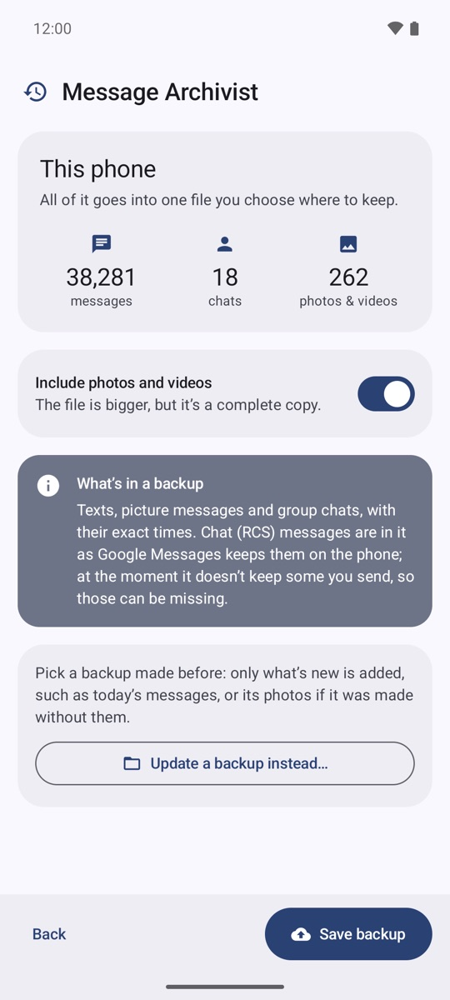
  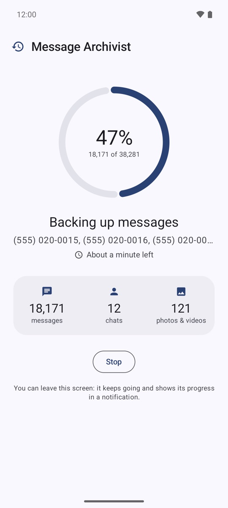
  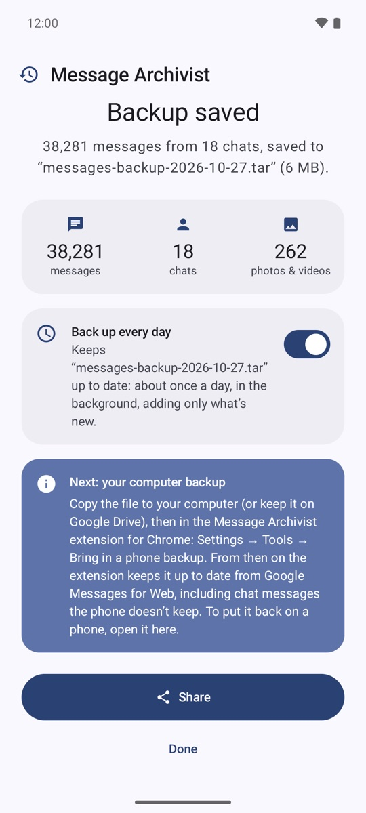
</p>

### Install the app

It needs Android 8 or later. Until it's on Google Play, it's installed by hand:

1. On the phone, download `message-archivist-android-v<version>.apk` from the newest release on the [Releases page](https://github.com/trikhster/message-archivist/releases). (Or download it on a computer and copy it to the phone.)
2. Open it. Android asks to allow installing apps from your browser or Files: allow it, then install.
3. Open **Message Archivist**. The first time you back up, it asks to read your texts, your contacts (optional: for chat names, favorites and contact photos) and to show notifications. If Android says reading texts is a *restricted setting*, open the app's info page (long-press its icon → **App info**), tap ⋮ → **Allow restricted settings**, and try again.

### The first screen

A card at the top says where your backup stands:

- **Your texts are backed up**: when the last backup ran, and to which file.
- **Automatic backup is on**: it's set up and the first one runs soon.
- **The last backup didn't work**: with the reason.
- **Your texts aren't backed up yet**.

Under it are how many messages, chats and photos and videos are on the phone, **Back up now** (or **Back up by itself**, to set up automatic backup) and **Settings**. Then come **Back up this phone** and **Restore a backup**; the gear at the top also opens Settings. The app follows the phone's light or dark theme, and on Android 12 and later its colours too.

### Back up a phone

1. Tap **Back up this phone**. It shows how many messages, chats and photos the phone has.
2. Leave **Include photos and videos** on for a complete copy, or turn it off for a small, quick file and add the photos later.
3. Tap **Save backup** and choose where to keep it: Downloads, Google Drive, or anywhere else the phone offers. The file is called `messages-backup-<date>.tar`.
4. It shows its progress (the messages, chats and photos so far, the chat it's on and the time left), also in a notification, so you can leave the app. **Stop** keeps the chats finished so far as a working backup.
5. **Backup saved** gives the counts and the file's name and size, with:
   - **Back up every day**: keeps this file up to date by itself (see [Keep it up to date](#keep-it-up-to-date)).
   - **Share**: sends the file to any app, such as Drive, email or Nearby Share.
   - **Next: your computer backup**: how to bring the file into the extension.

What a backup holds:

- Every text and picture message in every chat, group chats included, with its exact time and who sent it. Drafts and messages that never sent are left out.
- Photos, videos and audio, byte for byte (unless you turned them off).
- Each chat's people: their name and number, whether they're a favorite (a starred contact), and their contact photo. A group text's numbers are kept apart, not run together.
- Chat (RCS) messages as Google Messages keeps them on the phone (see [Good to know about the app](#good-to-know-about-the-app)).

Backing up never changes your SMS app. On a test phone, 38,281 messages and 262 photos took about 2½ minutes (50 seconds without the photos).

### Keep it up to date

- **Update a backup instead…** (on the backup screen) picks a backup you made before and adds only what's new: the messages since, and its photos if it was made without them and **Include photos and videos** is on now. Messages since deleted from the phone stay in the backup. A file on the phone's own storage is added to in place, in seconds; a file on Google Drive is copied to the phone, updated, and saved back whole.
- **Automatic backup** does the same by itself, in the background. Turn it on with **Back up every day** after a backup, or in Settings with **Back up by itself**, which asks for a **New file…** (backed up straight away) or **A backup I already have…** (brought up to date straight away). The first screen shows how the last one went.

<p align="center">
  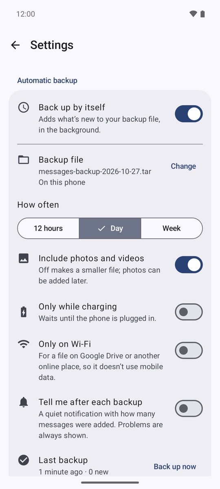
  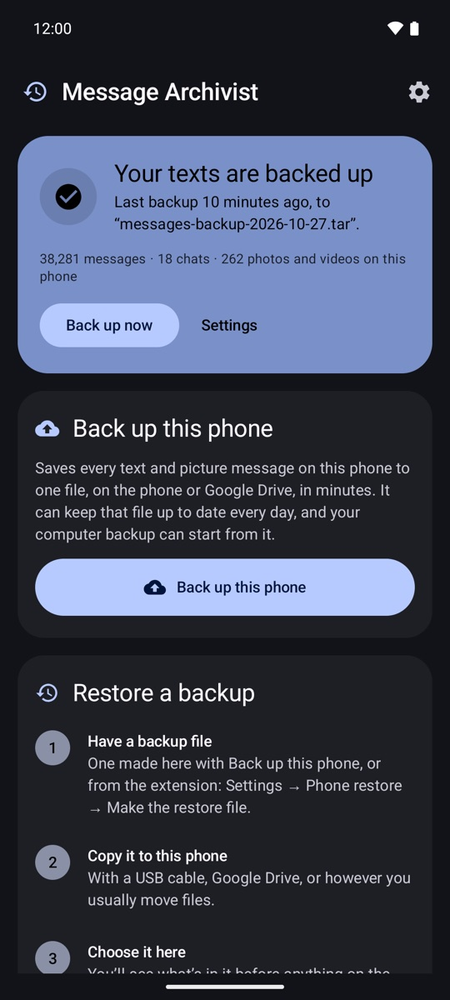
</p>

Settings (the gear on the first screen):

| Setting | What it does | Starts as |
|---|---|---|
| **Back up by itself** | Turns automatic backup on or off. | Off |
| **Backup file** | The file it keeps up to date, on this phone or online. **Change** picks another. | The file you chose |
| **How often** | Every 12 hours, every day or every week. Android picks the exact time, when the battery isn't low. | Day |
| **Include photos and videos** | Off makes a smaller file; the photos can be added later. | On |
| **Only while charging** | Waits until the phone is plugged in. | Off |
| **Only on Wi-Fi** | So a file kept online doesn't use mobile data. | On for a file online, off for one on the phone |
| **Tell me after each backup** | A quiet notification with how many messages were added. A backup that goes wrong is always shown. | Off |
| **Last backup** | When it last ran and how many messages it added, with **Back up now**. | |
| **About** | The version, a reminder that the app has no internet access, and **App permissions** (Android's settings page for the app). | |

### Put a backup back on a phone

<p align="center">
  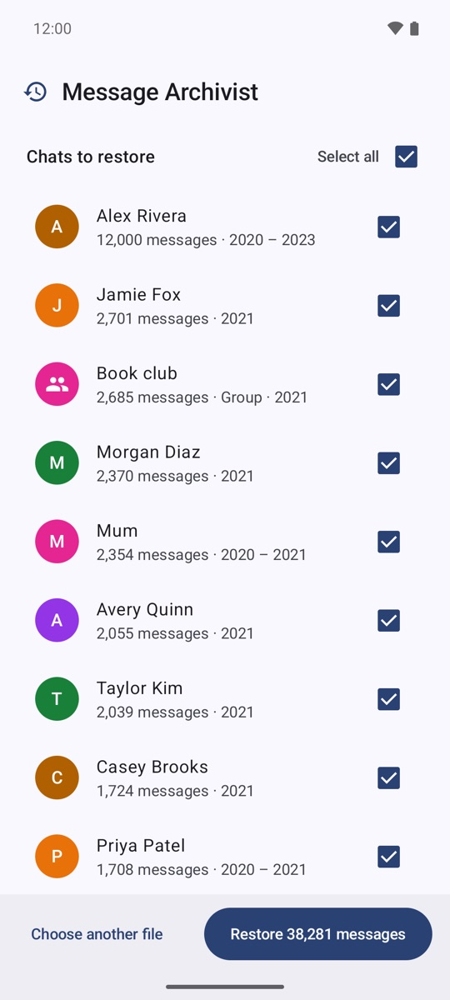
  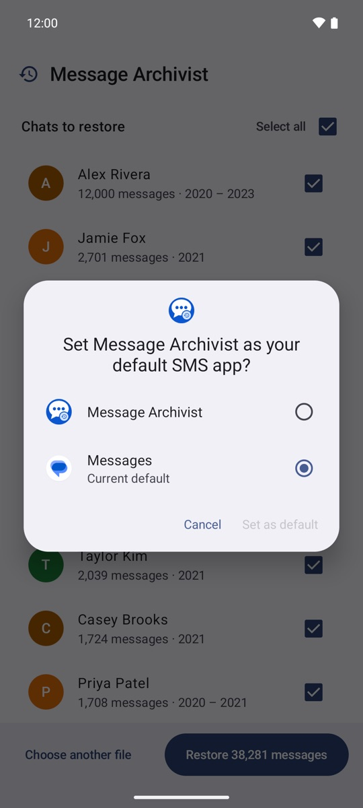
  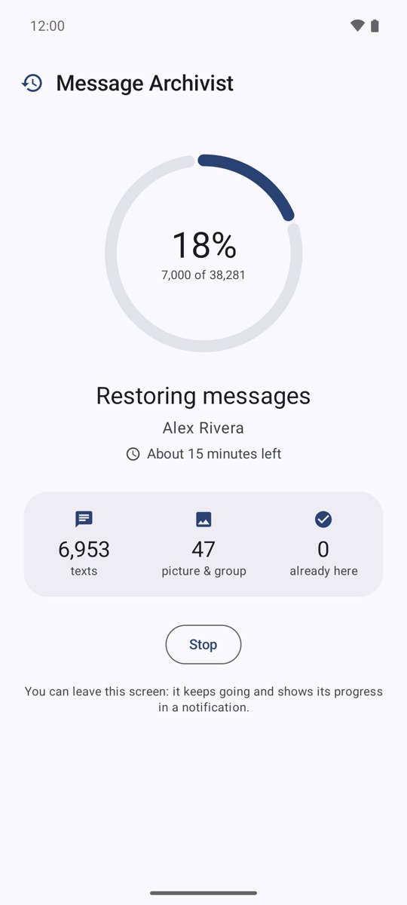
  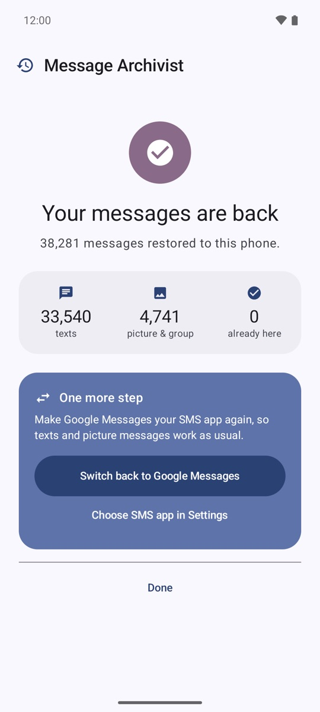
</p>

1. Copy a backup to the phone: one made with **Back up this phone**, or one the extension made (its Settings → **Phone restore** → **Make the restore file**).
2. Open Message Archivist on the phone and tap **Choose restore file** under **Restore a backup** (or open the file from Files or Google Drive with Message Archivist).
3. Check what's in it before anything on the phone changes: the backup's date, its messages, chats and photos and videos (with their size), roughly how long the restore takes, and every chat with its message count and years. All chats are ticked; untick any you don't want (**Select all** shows a dash when only some are ticked). If there are group chats and the phone doesn't know its own number, a box asks for it.
4. Tap **Restore N messages**. Android asks to make Message Archivist your **default SMS app**: say yes. Android only lets the SMS app add messages, so it needs to be, for the length of the restore.
5. It shows the percentage, the chat it's on, the time left, and how many texts, picture and group messages, and messages already on the phone it has done. A notification shows the same with **Stop**, so you can leave the app.
6. **Your messages are back**, with the counts. Then **One more step**: tap **Switch back to Google Messages** (or **Choose SMS app in Settings**) and say yes when Google Messages asks to be your SMS app again. The app then says **You're all set**.

It's safe to restore again:

- **Nothing is added twice.** Messages already on the phone are skipped; restoring the same file again just says **Already on this phone**.
- **Stopping keeps what's done.** **Restore again** carries on where it stopped.
- **Texts that arrive during a restore are kept**, with a notification. A picture message that arrives is fetched by Google Messages once it's your SMS app again.
- **Group chats come back as group chats**, with their photos and videos, in order.
- While Message Archivist is still your SMS app, a banner says so, with **Switch back**. It doesn't send texts: an app that asks it to gets a note to use Google Messages.

On a test phone, 38,281 messages went back in about 7½ minutes.

### With the extension

- **Phone first, then the extension.** In the extension's Settings → *Tools* → **Bring in a phone backup…**, choose the file. Chats are matched by phone number and their messages are marked "From phone"; when the extension next backs those chats up, it adds what the phone doesn't keep (the chat messages below, contact cards) without saving anything twice. Bring the file in again whenever you like: only what's new is added.
- **Favorites and contact photos** from the phone show in the viewer: favorite chats come first, with ⭐, then names A–Z, then numbers.
- **Computer to phone.** The extension's Settings → **Phone restore** → **Make the restore file** writes a backup the app can restore.

The [user guide](extension/README.md#the-android-app) has the details.

### Permissions and privacy

| Permission | What for | Asked |
|---|---|---|
| Read texts (SMS) | Backing up. | The first time you back up |
| Contacts (optional) | Chat names, favorites and contact photos. | The first time you back up |
| Notifications | Progress, results, and problems with automatic backup. | The first backup or restore |
| Default SMS app | Only during a restore: Android only lets the SMS app add messages. You switch back at the end. | When you tap Restore |
| Run at start-up | Keeps automatic backup scheduled after the phone restarts. | Never: allowed when it's installed |

The app has **no internet permission**, so it can't send anything anywhere: your messages go only where you save the file. See [PRIVACY.md](PRIVACY.md).

### Good to know about the app

- **Chat (RCS) messages.** Since mid-2026 a Google Messages bug stops some RCS messages you send being stored on the phone, so no phone backup has them. The extension can still read them: bring the phone backup into the extension and let it back those chats up.
- **Google Drive can't add to a file**, so an automatic backup kept on Drive uploads the whole file each time. With photos that can be large: leave **Only on Wi-Fi** on, or keep the file on the phone and copy it somewhere now and then.
- **Android decides when automatic backups run**: around the time you chose, when the battery isn't low (and when charging or on Wi-Fi, if you asked). A run Android cuts short keeps what it did and carries on next time.
- **Restored messages are texts and picture messages.** RCS chats go back as ordinary SMS and MMS. Times in a backup the extension made are to the minute (that's what Google Messages for Web shows); a phone backup's are exact.
- **The time left is a guide.** On a slower phone the restore's estimate can start out too high.
- **iPhones can't import texts**, so restoring needs an Android phone.
- **Updating the app.** Every release's APK is signed with the same key, so a new version installs over the old one and keeps your settings. Each release's notes give the key's SHA-256 fingerprint. A test build (a debug APK from the Check workflow, or one you built yourself) has a different signature: uninstall it before installing a release, which turns automatic backup off, but your backup files stay where they are.
- Some launchers shorten the name to "Message Ar…".

## Project layout

```
extension/   the extension itself (load this folder in Chrome)
  manifest.json             extension manifest; its version is the release version
  content.js                runs on messages.google.com: reading chats, backing up, analyzing
  library.js                shared by content.js and Settings: merging, the library's index, completeness checks
  writer.html/js            small extension frame that owns the backup folder and writes into it
  background.js             scheduled jobs, date-range downloads, notifications
  popup.html/js             toolbar popup
  options.html/js           settings page, including import of earlier exports and backup health
  viewer.html/js            the archive viewer (copied into the library as index.html + viewer.js)
  zip.js                    small zip writer and reader
  theme.css / theme.js      Google Messages-style look, light/dark theme and toggle
  icons/icon.svg            icon source; PNGs are rendered from it
android/                    the Android app, which backs a phone up (by itself if asked) and puts backups back (Kotlin, Gradle)
scripts/                    checks, packaging, setting the version
test/                       tests for bringing phone backups in, and tools for comparing backups
notes/                      developer notes (an Obsidian vault; start at notes/Home.md)
docs/screenshots/           pictures for this page (made-up chats); android/ has the app's
.github/workflows/          CI checks and release packaging
```

## Development

See [CONTRIBUTING.md](CONTRIBUTING.md) for how to report problems and suggest changes.

Requires Node.js 18 or later (used only for checks and packaging, not at runtime).

```bash
npm run check
```

That checks every script's syntax, validates the manifest, confirms every file it references exists, and confirms `package.json`, `manifest.json` and the Android app have the same version.

```bash
npm test
```

That brings made-up phone backups into a made-up library and checks that chats are matched by number, nothing is added twice, a later backup from Google Messages for Web recognises the phone's messages, and phone chats are shown as "From phone", with numbers formatted and favorites first.

```bash
npm run package
```

That builds `dist/message-archivist-extension-v<version>.zip`, which is ready to attach to a GitHub release or upload to the Chrome Web Store, and prints its SHA-256.

```bash
cd android && ./gradlew assembleDebug
```

That builds the Android app (it needs JDK 17 and the Android SDK) into `android/app/build/outputs/apk/debug/app-debug.apk`. CI builds it on every push too. How it works and how to test it on an emulator: `notes/Modules/Android app.md` and `notes/Testing.md`.

## Versioning and releases

Versions have four parts, production.major.minor.patch, such as 0.0.1.0. The first is 0 until the first production release, and those releases are published as GitHub pre-releases; the other three follow [Semantic Versioning](https://semver.org/) (major for changes that break existing backups or need setup again, minor for new features, patch for fixes). The extension and the Android app share one version.

1. Add the changes under **Unreleased** in [CHANGELOG.md](CHANGELOG.md), then rename that heading to the new version and date.
2. Set the version in `package.json`, the extension's manifest and the Android app, and commit:

   ```bash
   npm run set-version -- 0.0.2.0
   ```

3. Tag the commit and push the tag:

   ```bash
   git tag -a v0.0.2.0 -m "Message Archivist 0.0.2.0"
   ```

   ```bash
   git push origin v0.0.2.0
   ```

When a `v*` tag is pushed, GitHub Actions checks that the tag matches the manifest version, builds the extension zip and the Android APK (signed with the project's key, kept in the repository's secrets), and publishes a GitHub Release with both attached, their SHA-256 checksums and the signing key's fingerprint. See `notes/Releasing.md`.

## License

[Apache License 2.0](LICENSE). See [NOTICE](NOTICE) for attributions.
