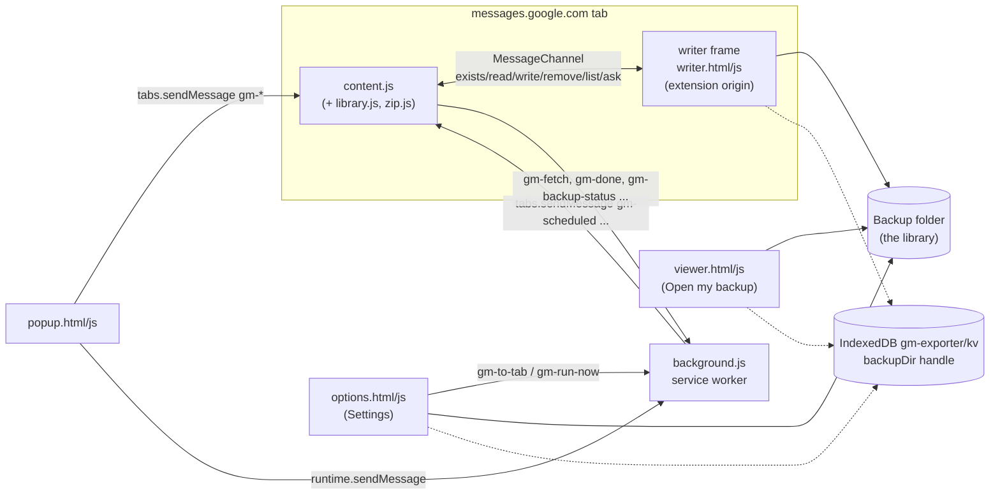

# Architecture

A Chrome Manifest V3 extension with no server and no build step. Everything runs in the browser; backups are written straight into a folder the user picks (File System Access API).

For every file, section and function, open the canvas `Code map.canvas` ([[Code map]]).

## The parts
- **Content script** ([[Content script]]): reads the conversation out of Google Messages' page, drives scrolling and the photo viewer, shows the progress panel (the HUD), and decides what to save. It can't touch the backup folder itself (see below).
- **Writer frame** ([[Writer frame]]): a hidden `writer.html` iframe the content script adds to the Messages page. It's an extension page, so it can use the folder handle stored in the extension's IndexedDB. The content script talks to it over a private `MessageChannel`; blobs pass straight through.
- **Library module** ([[Library module]]): pure functions shared by the content script and the Settings page: merging, the per-chat files, the index (`data.js`), completeness checks, photo statuses, checksums. No page or extension APIs.
- **Background worker** ([[Background worker]]): alarms for scheduled backups, fetching media the page can't read (CORS), downloads into a subfolder, notifications and the badge, moving Messages into its own window, relaying Settings' actions to the Messages tab.
- **Popup** ([[Popup]]): the per-chat card, start buttons, photo actions.
- **App modules** ([[Importers]]): one file per app beside Google Messages, the core (`modules/`: WhatsApp, Instagram and Messenger, Snapchat, Telegram, Discord, TikTok, and iMessage and Signal for later): its name, colour, folder, how to get its export and the reader of it, registered with `GMLib.addModule` ([[Sources]]). Loaded wherever the archive is read or written (Settings, the viewer, the content script); `import.js` (`GMImport`, Settings only) reads exports with them, including those a phone backup carries.
- **Settings** ([[Settings page]]): choosing the folder, backup health, photo checks, deleting chats, importing older exports, restore-to-phone file, schedules.
- **Viewer** ([[Viewer]]): the offline archive viewer. Opened from the extension with `?library=1` it reads the folder directly (and can save labels, flags and who's who); a copy saved in the folder as `index.html` works from disk.
- **Notes for Obsidian** ([[Obsidian notes]]): the archive as an Obsidian vault, written by Settings and after backups.

## The app
`app/` ([[App]]) is the same Settings page and viewer as an installed web app on Chrome or Edge: its own window and icon, offline, served from GitHub Pages from release tags. `app/app.js` stands in for the extension APIs those pages use (storage in the app's IndexedDB; opening windows; anything that needs Google Messages answers that the extension does it), and `scripts/build-app.mjs` puts it together. It reads and writes the same backup folder, through its own folder permission; the extension still does every Google Messages backup. See [[Desktop app]] for what's next (the app starting the extension's backups, iMessage through a native helper).

## Why the writer frame exists
The folder handle belongs to the extension's origin. A content script runs in the page's origin (messages.google.com) for storage purposes, so it can't read the handle from the extension's IndexedDB. An extension iframe can, and Chrome lets it keep the permission. Every write therefore goes content script → `FrameSink` → `MessageChannel` → `writer.js`. See [[Decisions]].

## The Android app
`android/` holds the Android app ([[Android app]]), a separate Gradle project (the extension stays build-free). The extension writes a [[Restore package]] (Settings → Phone restore); the user copies it to the phone, and the app becomes the default SMS app for the restore and writes the messages into the phone's SMS/MMS database. The app also backs a phone up into the same format (reading with `READ_SMS`).

## Where state lives
- Backup data: the folder ([[Library format]]).
- Settings, run history, per-chat status: `chrome.storage.local` ([[Storage and settings]]).
- The folder handle: IndexedDB `gm-exporter` / `kv` / `backupDir` (the extension's origin; the app has its own, with its own handle).
- Flags in a viewer not opened from the extension: that browser's `localStorage`.

## How a backup is started
popup → `gm-export` → `run()` → `folderRun()` → `backupConversation()` per chat → `writeIndex()` → `finishRun()`. Full story in [[Backup run]]; the messages are listed in [[Messages between parts]].
