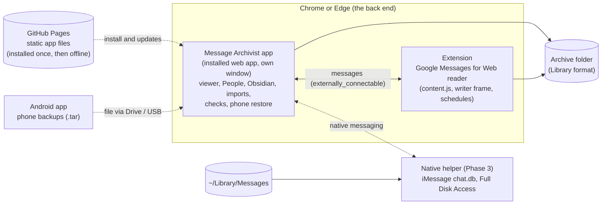

# Desktop app (plan)

**Status: Phase 1 built (unreleased): the installable app, [[App]].** Phases 2–4 are proposals. An app of its own for the archive, launched like any other app (its own window and icon in the Dock, Start menu or taskbar, no browser tabs), that runs on the **Chrome or Edge** already on the computer rather than shipping an engine of its own. Beside it, the Chrome extension keeps reading Google Messages for Web and the [[Android app]] keeps backing up the phone. This note is the plan to agree on before any code; decisions it needs are at the end.

The owner's brief (2026-10-27): launch it separately from Chrome or Edge, but use them as the program's back end. That replaced the earlier recommendation (a Tauri app with its own web view); Tauri and Electron are kept below for comparison.

## Why
The archive takes conversations from many apps ([[Sources]]), with who's who across them ([[Sources]] → People) and notes for Obsidian ([[Obsidian notes]]). Most of the work is no longer about one web page, and an extension's pages are the wrong home for some of it:

| Need | As extension pages today | As an app on Chrome or Edge |
|---|---|---|
| Open it like an app | through the extension's icon or Settings, in a browser tab | its own window and icon; can open at login |
| Keep access to the archive folder | Chrome asks again after a restart ("Chrome needs your OK again") | an installed app can keep the permission ("Allow on every visit") |
| Open a phone backup by double-clicking it | no: every file is picked by hand | the app registers for `.tar` files (File Handling) |
| Edge | the extension would need Edge Add-ons as well | the same app installs from Edge |
| iMessage (`~/Library/Messages/chat.db`), Signal Desktop, iPhone backups | impossible: no browser can read them | still impossible for the browser alone: a small native helper (Phase 3) |
| Search across hundreds of thousands of messages | each page loads chats into memory | an index kept by the app (IndexedDB or SQLite in WebAssembly) |

**What can't move:** reading Google Messages for Web. It depends on that page ([[Google Messages page]], [[Content script]]), so it stays an extension, and the app asks it to run.

## How it runs: an installed web app on Chrome or Edge
The app is a **progressive web app**: the same HTML and JavaScript as the extension's pages, served from one web address, which Chrome or Edge installs as an app (⋮ → Cast, save and share → Install, or the install icon in the address bar). Installed, it:
- opens in **its own window**, with its own icon in the Dock, Start menu or taskbar and in the app switcher, and can start at login (Chrome's and Edge's app settings);
- uses Chrome's or Edge's engine, so everything the extension's pages already do works unchanged: the **File System Access API** for the archive folder (with the permission kept for an installed app), `DecompressionStream`, the viewer, `library.js`, `modules/` and `import.js`, `obsidian.js`;
- works **offline**: a service worker keeps the app's files, so after the first visit it never needs the network;
- opens files given to it: a `file_handlers` entry in its manifest makes it an "Open with" choice for phone backups (`.tar`), and `launch_handler` keeps it to one window;
- reads and writes **only the archive folder** the owner picks. Nothing goes to the web address it was installed from: the page is static files, with no server code and no requests back (a `connect-src 'self'` policy and no analytics).

- **The archive folder is the contract.** Everything reads and writes the format in [[Library format]]. The app adds nothing the extension and `index.html` from disk can't read; its search index is a cache, rebuilt from the archive.
- **One codebase.** The app is the extension's own pages (Settings' archive tools, the viewer), built from the same files: `library.js` ([[Library module]]), `importers/` ([[Importers]]), `obsidian.js`, and `archive.js` (Phase 0). No second UI, no second engine to test.
- **The app and the extension talk.** The extension lists the app's address in `externally_connectable`, so the app can ask it to back up Google Messages (it opens or uses the Messages tab, as "Back up everything" does today) and show each run's progress and result. The extension's ID needs fixing for that (a `key` in `manifest.json`, or the store's ID).
- **Two writers, one lock.** The app and the extension can both write the archive. Each takes `archive.lock` (owner, started, a heartbeat every 30 s; stale after 2 min) for the length of a run, and re-reads `data.js` just before writing it, so neither drops the other's chats. (Today the extension is the only writer.)
- **What a browser can't do** goes to a small **native helper**, installed separately and only for what needs it (iMessage first): a signed program Chrome or Edge starts through **native messaging** when the app asks. It reads `chat.db` with Full Disk Access and hands back messages in the library's shape; the app writes them. The browser stays the back end; the helper is an adapter.

### Where it's served from
An installed web app needs one `https` address to install from. The plan is **GitHub Pages from this public repository** (`trikhster.github.io/message-archivist/app/`), deployed by a pinned workflow from release tags only, so what's served is exactly a tagged release. Chrome and Edge also keep the installed app's files, so it starts with no network.

The trust model differs from an extension's: a store-installed extension changes only when a new version is published, while a web app takes whatever its address serves next. Mitigations: deploy only from signed release tags; publish each release's file hashes; a service worker that updates only between sessions and says so; no third-party scripts. The extension can keep its own copies of every page, so someone who'd rather not trust a hosted app keeps today's way of working.

**Not chosen:**
- **The extension's own pages in an app window**, launched by a small script (`open -na "Google Chrome" --args --app=chrome-extension://<id>/viewer.html`): no hosting, but a script per browser and per computer, nothing to install for most people, and extension pages can't be installed as apps.
- **A local server** (the helper serving the app on `localhost`): no hosting, but then the helper is needed by everyone, not only for iMessage.

### Compared with Tauri and Electron

| | **Web app on Chrome or Edge** | **Tauri 2** | **Electron** |
|---|---|---|---|
| What the owner installs | nothing new: "Install" from the browser | a 5–15 MB app | a 100 MB+ app |
| Engine | the Chrome or Edge already there (Chromium, as the extension) | WebKit on Mac, WebView2 on Windows | its own Chromium |
| The extension's pages | run unchanged | need an `io` layer (WebKit has no File System Access) and testing in WebKit | run unchanged |
| iMessage and other local databases | a native helper, through native messaging | built in (Rust) | built in (Node) |
| Updates | each release, served as static files | its updater, signed | electron-updater, signed |
| Signing | none for the app; the helper (only if used) is signed and notarized | the app, signed and notarized | the app, signed and notarized |
| Runs with the browser closed | no: it *is* the browser, in its own window (it opens Chrome or Edge in the background) | yes | yes |

**Recommendation: the web app on Chrome or Edge**, as the owner asked. It reuses everything already built, adds no engine, toolchain or installer for most people, and Chrome and Edge are what the extension needs anyway. Tauri stays the fallback if a fully native app is wanted later.

## What moves where

| Today | Where it ends up | Notes |
|---|---|---|
| `content.js`, `writer.html/js`, `background.js`, `popup.*` | **extension** (unchanged) | reading Google Messages, its schedules, the popup; answers the app's messages |
| `library.js`, `modules/`, `import.js`, `obsidian.js`, `zip.js`, `theme.*` | **shared** (unchanged) | plain functions; already loaded by the extension's pages |
| `options.js` archive operations (import, merge, index, checksums, delete, photo and file checks, Phone restore file, Obsidian notes) | **`archive.js`, shared** (Phase 0) | behind the `io` interface, so Node tests run them too |
| `options.js` / `options.html` (Settings) | **extension** keeps the Google Messages parts (folder, schedules, the backup list, "Back up everything", Basic/Advanced); **app** gets Home, Backups, Phone restore, Tools | the extension's Settings can point to the app for archive work |
| `viewer.html/js` | **both** | the app's main view; still copied into the archive as `index.html` so it opens from disk |
| (new) app shell: web app manifest, service worker, file handling, the lock | **app** | Phase 1 |
| (new) iMessage reader | **native helper** | Phase 3 |
| `android/` | **unchanged** | still writes phone backups; the app imports them (and opens them by double-click) |

## iMessage (Phase 3, through the native helper)
The first source only a native helper can add. On a Mac signed in to iMessage (with "Text Message Forwarding" from an iPhone, the iPhone's SMS too), every conversation is in `~/Library/Messages`.

**Access.** Reading it needs **Full Disk Access** (System Settings → Privacy & Security → Full Disk Access), granted to the helper, not to Chrome or Edge. The app explains why and opens that pane (`x-apple.systempreferences:com.apple.preference.security?Privacy_AllFiles`), then checks by asking the helper to read the folder. Nothing is ever written there.

**Reading safely.** Messages keeps `chat.db` open in WAL mode, so the newest messages are often still in `chat.db-wal`. The helper copies `chat.db`, `chat.db-wal` and `chat.db-shm` together into a private temporary folder and opens the copy read-only, so it never locks or alters the real one.

**What's in it** (macOS 13 and later; older versions differ, and each macOS release can change it):

| Table | Used for |
|---|---|
| `chat` | a conversation: `guid`, `chat_identifier`, `display_name` (group names), `style` (43 group, 45 one-to-one), `service_name` |
| `handle` | a person: `id` (a phone number or email), `service` |
| `chat_handle_join`, `chat_message_join` | who's in each chat; which messages are in it |
| `message` | `guid`, `text`, `attributedBody`, `date` (nanoseconds since 2001-01-01), `is_from_me`, `handle_id`, `service` (iMessage, SMS, RCS), `associated_message_guid` and `associated_message_type`, `thread_originator_guid`, `date_edited`, `date_retracted`, `item_type`, `group_title` |
| `attachment`, `message_attachment_join` | `filename` (`~/Library/Messages/Attachments/…`), `mime_type`, `transfer_name`, `total_bytes`, `is_sticker` |

**Into the archive** (one record per message, as [[Sources]] describes):
- **Chats:** `service: 'imessage'`, `conversation_id: 'imessage:<chat guid>'`, in `conversations/iMessage/<chat>/`. Its own source, never merged with Google Messages' texts ([[Sources]]: source, then account).
- **Account:** which Apple ID or number the chat used (`chat.account_login`, `message.account` such as `E:you@icloud.com` or `P:+15550100000`), so a second Apple ID (or an old iPhone's number) is a second account, as for Google Messages. Each message keeps which network carried it (`network`: iMessage, SMS, RCS).
- **People:** a chat's handle (a number or an email) goes in its contact card, so People ([[Sources]] → People) joins it with the same number's texts and WhatsApp chats by itself, and an email with the same email elsewhere.
- **IDs:** `imessage:<message guid>`, so importing again (every hour, say) adds only what's new.
- **Text:** from `text`, or for newer messages (where `text` is empty) decoded from `attributedBody`, an archived `NSAttributedString` ("typedstream"). This needs a small decoder of our own: the best-known open-source one (imessage-exporter's crates) is GPL-3.0, and this project is Apache-2.0.
- **Reactions:** `associated_message_type` 2000–2005 add a tapback (love, like, dislike, laugh, emphasize, question) to the message in `associated_message_guid` (`p:<part>/<guid>`); 3000–3005 remove one; newer macOS adds emoji and sticker reactions. They become `reactions` on that message, not messages of their own.
- **Replies, edits, unsends:** `thread_originator_guid` → `reply_to`; `date_edited` → `edited` (the latest text, earlier versions noted); `date_retracted` → shown as "(unsent)".
- **Group events:** `item_type` and `group_title` (renamed, joined, left) → `kind: 'system'`.
- **Attachments:** the helper hands each file to the app, which saves it byte for byte; missing ones are listed as not saved. HEIC stays as it is (Chrome and Edge don't show HEIC, so display copies come with search, Phase 4).
- **Names:** `chat.db` has numbers and emails, not names. Names come from People (chats already in the archive with the same number), then optionally from Contacts (asked for separately).
- **You:** `is_from_me`, so no "Which one is you?".

**Tests:** a made-up `chat.db` built by a script with the `sqlite3` tool that ships with macOS (the schema above, invented people and messages), covering text from `attributedBody`, tapbacks, a reply, an edit, a group rename and an attachment. Never a real database.

## Phases

| Phase | What | Done when |
|---|---|---|
| **0. Groundwork** (in this repo; useful anyway) | `archive.js` (the archive operations, against `io`), with the extension's Settings using it; the `archive.lock` protocol in the extension's runs; Node tests for `archive.js` on an in-memory `io` | Settings works exactly as before; `npm test` covers importing, merging, deleting and the index |
| **1. The app** (built, unreleased: [[App]]) | `app/`: web app manifest, icons, service worker, `file_handlers` for `.tar`, `launch_handler`; Home, Backups, Tools, Phone restore and the viewer from the shared files; the folder permission kept; GitHub Pages deploy from release tags, with published hashes | the app installs from Chrome and from Edge, opens from the Dock or Start menu, works offline, and imports a phone backup opened from Finder or Explorer |
| **2. App and extension together** | `externally_connectable`: the app starts and follows the extension's Google Messages backups and shows their runs; a fixed extension ID; the extension's Settings points to the app for archive work | one place shows every source's last run, and a Google Messages backup can be started from the app |
| **3. iMessage** | the native helper (signed, notarized; installs its native messaging manifest for Chrome and Edge); Full Disk Access; the `chat.db` reading and mapping above; attachments | iMessage chats appear beside the rest, joined with the same people's other chats |
| **4. Search and more sources** | a full-text index across every app (rebuildable, kept by the app); display copies of HEIC photos; iPhone backups (an unencrypted Finder backup's `sms.db`: the same tables as `chat.db`; its WhatsApp `ChatStorage.sqlite`, every chat at once instead of one export each), WhatsApp for Mac's own databases (check which file holds the messages first, [[Sources]]) and Signal Desktop through the helper (check Signal's keychain-protected key first); Windows for the helper | searching years of every app is instant; each new source a tested importer |

Already done in the extension, and moving with the shared code: **People** (one person across apps, accounts and numbers, joined and split by hand; [[Sources]] → People, [[Viewer]]) and **notes for Obsidian** ([[Obsidian notes]]).

## Security and privacy
- **Nothing leaves the computer.** The app is static files; it reads and writes the chosen archive folder and talks only to the extension and, if installed, the helper. No accounts, no analytics, no requests to its own address after it's installed (beyond the browser fetching a new release).
- **Hosted code is a trust decision** (see "Where it's served from"): deploys from release tags only, published hashes, no third-party scripts.
- **The helper reads, never writes, other apps' data,** and only does what the app asks through native messaging (an allow-list of commands). Full Disk Access is asked for only when iMessage is turned on, with what it's for.
- The same rules as the rest of the project: nothing personal in code, tests, logs or screenshots ([[Home]]); logs hold counts, never message text.

## Repository and releases
- `app/`: the web app's manifest, service worker, stand-ins and icons; `scripts/build-app.mjs` adds the extension's pages and the files they load (copied, nothing compiled). See [[App]].
- `helper/` (Phase 3): the native helper and its installer, built on macOS in CI.
- GitHub Releases carry the extension zip, the APK and (later) the helper; GitHub Pages serves the app.
- **Versions:** one version for all of them, the four-part `P.M.m.p` ([[Releasing]]). A macOS helper needs three whole numbers: `P.(M·100+m).p` (0.0.1.0 → 0.1.0, 0.1.0.0 → 0.100.0, 1.0.0.0 → 1.0.0), which only ever grows, like the Android `versionCode`.

## Risks
- **The app needs Chrome or Edge.** It runs on them, as the owner wants; Safari and Firefox can't install it with folder access.
- **Hosted code can change** under an installed app. Mitigation: tag-only deploys, hashes, the extension's own pages as the fallback.
- **Apple changes `chat.db`** with macOS releases. Mitigation: read by column names, test on each new macOS, and say plainly when something can't be read.
- **Two writers** could corrupt the index. Mitigation: the lock and the re-read before writing (Phase 0), before the app ever writes.
- **Folder permission prompts** still appear if Chrome or Edge decide to ask again (a revoked permission, a moved folder). Mitigation: the app says why and asks once.

## Decisions needed
1. ~~**Serve the app from GitHub Pages**~~ **Decided 2026-10-27**: yes, deployed from release tags ([[Releasing]] → The app).
2. **Chrome and Edge both,** with the extension in the Edge Add-ons store too?
3. **Phase 0 now?** It improves the extension on its own (shared code, tests, safe concurrent writes) whether or not the app follows.
4. **iMessage helper**: an Apple Developer account ($99 a year) to sign and notarize it, when Phase 3 comes.
5. **Should the extension's Settings shrink** to Google Messages only once the app exists, sending people to the app for everything else?

Related: [[Architecture]], [[Sources]], [[Importers]], [[Obsidian notes]], [[Library format]], [[Settings page]], [[Viewer]], [[Android app]], [[Restore package]], [[Decisions]].
