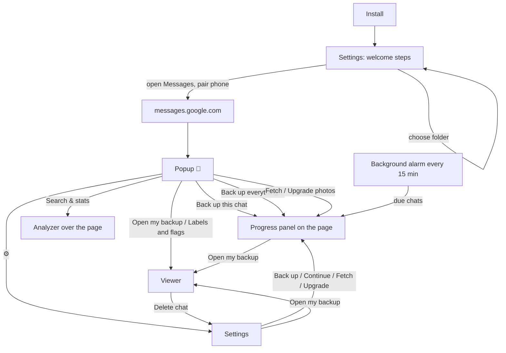

# UI map

Every place people interact with the extension, what each control does, and the edge cases each one has to handle. The 0.5.0.0 redesign is described per surface under **0.5.0.0**. Code: [[Popup]], [[Settings page]], [[Viewer]], [[Content script]] (progress panel).

## Popup (toolbar 💬)
| State | What it shows | Edge cases |
|---|---|---|
| No folder | Step 1 card: **Choose a folder** (opens Settings `#folder`) | folder chosen but permission lapsed → still works; the page asks when a backup starts |
| Not on Messages | **Open Google Messages** (focuses an open tab or opens one) | Messages open in another window |
| Page not answering | "Reload the Messages page" | tab open before the extension was installed or reloaded: `send()` injects the scripts first, so this only shows if that fails too |
| Not paired | pairing steps | the list is still loading (says "give it a moment") |
| No chat open | "Pick a chat", **Back up everything…** | |
| Chat open | name, picture, status line, **Back up this chat** (or **Carry on backing up**), **Search & stats**, auto-backup select, photos card (**Fetch N** / **Upgrade N**), **🏷 Labels and flags…** | a run already going (buttons answer "already running"); chat not backed up yet (no photos card, no labels); speed-run chat (status "Messages backed up, photos to fetch") |
| More options | what to save (photos, full size), a date range as a zip, **Back up everything** (3 deliberate steps), page diagnostics | custom range with from > to; range of 0 messages |

## Progress panel (on the Messages page)
| Moment | Controls | Edge cases |
|---|---|---|
| Start card | **Start backup** / **Speed run** / close | folder permission needed first (the writer frame's **Allow** card appears above it); chat open is not the one expected |
| Running (centred, page blocked) | **Pause / Resume**, **Stop…** (confirm: **Stop** / **Keep going**), minimise to the corner | tab hidden or window minimised → pauses and brings the window back; page reloaded mid-run (journal recovers it next time); phone goes offline (spinner never stops → not called complete) |
| Waiting for an answer | the question's buttons | |
| Finished / stopped / failed (docked) | **Carry on now**, **Open my backup**, **Copy log**, **Close** | stopped part-way: only "Carry on now" is offered first |
| "Back up everything" confirm | **Start export** after the count | 0 conversations found |

## Settings (before 0.5.0.0)
One long page: welcome steps → **Your backups** (status, Open my backup, Back up everything, Check for problems) → **Chats kept up to date** (a table of schedules with its own status column, Back up all now, Add chats…) → **Check for problems** (a second table of the same chats with other columns and six buttons) → **Where your backups are kept** (folder, import) → **More settings** (14 options, phone restore, case note, past runs). Problems: the same chat appears in two tables with different information; photo actions live in a third place; phone restore is hidden at the bottom of "More settings"; "full size" is three separate settings; every storage change re-rendered the whole page, including 30 full logs.

## Settings (0.5.0.0)
Tabs: **Home** · **Backups** · **Phone restore** · **Tools** · **Settings** (Basic / Advanced).
- **Home**: first-run steps until there's a backup; then one status sentence, the next thing to do (finish unfinished chats, fetch photos, conversations not backed up yet) and **Open my backup**, **Back up everything…**.
- **Backups** (the index): one row per chat, whether it's in the backup, on the auto-backup list, or both. Columns: chat, status, messages and dates, photos by status, auto backup (select). Row actions: **Back up now / Continue**, **Fetch photos**, **Upgrade photos**, **Delete…**; click a row for its checks. Filters: All, Needs attention, Unfinished, Photos to fetch, Kept up to date; a search box. Bulk: **Back up kept-up-to-date chats now**, **Add chats…**, and the fix-all buttons that apply.
- **Phone restore**: the restore file for the Android app (and, folded away, the SMS Backup & Restore XML), which chats can and can't be restored and why, include photos (on by default).
- **Home, first run**: four steps: choose a folder; **Start with your phone (fastest)** (Bring in a phone backup…, a link to the app; skip without an Android phone); connect Google Messages; back up everything once, then keep it up to date.
- **Tools**: check files unchanged, check every photo, find duplicates, bring in other backups (a folder, a zip, or a phone backup from the Android app: a confirm says how many chats match by phone number and how many are new), past runs (logs shown when opened).
- **Settings**: Basic (folder, photo quality, photos on/off, backup window, notifications, theme) and Advanced (patience, corner, full-size between batches, read twice, link-preview pictures, page markup, date-range zip folder, case note).

Edge cases the index handles: folder not chosen (Home shows the steps, other tabs say so); permission lapsed (one **Allow access** button, then everything loads); library from an older version (rows without `media`/`status` fall back); a chat folder deleted in Finder ("Folder missing", Delete… tidies it); an auto-backup chat never backed up (row with "Not backed up yet"); thousands of chats (filtering and searching are instant, rows render in pages).

## Viewer
| Tab | Controls | Edge cases |
|---|---|---|
| Chats | list (search, sort, label folders), header (find in chat, prev/next, media only, jump to month, 🏷 Labels, Analyze, delete, print), per message ☆ flag and 🏷 labels, people chips | 100k-message chat (0.5.0.0: drawn a month at a time as you scroll); chat.js missing; no dated messages |
| Search | words/phrases, chat, person, label, kind, weekday, hour, dates, sort, context, reset, print, CSV | no filters → help; thousands of results (shown 200 at a time) |
| Media | chat, person, kind, status filter (with counts), tiles, lightbox (prev/next, show in chat) | 20k photos (0.5.0.0: read from disk only when near the screen); items without a file (placeholder → opens the message) |
| Review | flagged/label filter, chat, find, sort, print, CSV, edit flag/labels in place | nothing marked → help |
| Analysis | chat, person, period, every chart clickable | live analyzer with one chat |
| About | flags export/import, completeness, conversations table | not opened from the extension (flags in the browser only) |
Keys: 1–6 tabs, / search, n/N hits, j/k chats, p print, t theme, ? help.

## The Android app
| Moment | Controls | Edge cases |
|---|---|---|
| Start | status card (backed up / automatic backup on / last run failed / not yet; the phone's counts; **Back up now** or **Back up by itself**, **Settings**), gear → Settings; **Back up this phone** card; **Restore a backup** card with the three steps, **Choose restore file** (or open a `.tar` from Files/Drive) | SMS permission refused: card with **App settings**; last daily run failed: says why |
| Back up tapped | Android asks for SMS, contacts (optional) and notifications; then this phone's counts, **Include photos and videos**, what's in a backup, **Update a backup instead…**; **Back**, **Save backup** → Android's save screen | no texts on the phone (Save off); contacts refused (chats named by number); save screen cancelled (stays put); the picked file isn't a backup (says so) |
| Backing up | ring, current chat, time left, messages / chats / photos, **Stop**; notification with **Stop** | stopped: the file keeps the chats finished; a photo that can't be read is left out and counted; writing fails: the file is deleted, says why |
| Backup done | counts (an update: added, and the file's total), file name and size, photos to add later, **Back up automatically** switch, "Next: your computer backup", **Share**, **Done** | stopped (no daily switch); some photos unreadable (counted) |
| Restore: choosing a file | **Choose restore file** → Android's file picker | not a restore file / newer format (says so); a file from Drive that isn't seekable (open fails with a message) |
| File read | backup date, time estimate, messages / chats / photos (and their size), why it becomes the SMS app; chats with ticks and **Select all**; **Choose another file**, **Restore N messages** | no chat ticked (button says to choose one); group chats and the phone doesn't know its own number: a number field appears, Restore again (or leave empty to go ahead) |
| Restore tapped | notification permission (once), then Android's "make Message Archivist your SMS app?" | refused: says it's needed and stays put |
| Running | ring with percentage, current chat, time left, counts, **Stop**; notification with progress and **Stop**; screen kept on | a text arrives (saved + notification); a picture message arrives (notification: Google Messages fetches it later); app closed (service keeps going) |
| Done | result (texts, picture/group messages, already on the phone, couldn't add); **Switch back to Google Messages**, **Choose SMS app in Settings**; then "You're all set"; **Done** (to the start) | everything already there ("Already on this phone"); stopped part-way (**Restore again** carries on, nothing added twice); failed (**Try again**); app reopened after switching back (Android ended its process): the result is shown again |
| Settings | automatic backup on/off (new file or one I have, backed up now), file and **Change**, how often (12 h / day / week), photos, only charging, only Wi-Fi, tell me after each, last backup and **Back up now**; About, App permissions | turning on without a file: asks where; online file: Wi-Fi only by default |
| Any screen but Running | banner when it's still the SMS app, **Switch back** | |
Other apps' "send a text" requests while it's the SMS app: a screen saying to use Google Messages.

## Background, no UI
Alarm every 15 minutes runs due chats; opens Messages in a (compact) window if it isn't open; skips with a "!" badge when the phone isn't paired; notification at the end.
